<div align="center">
  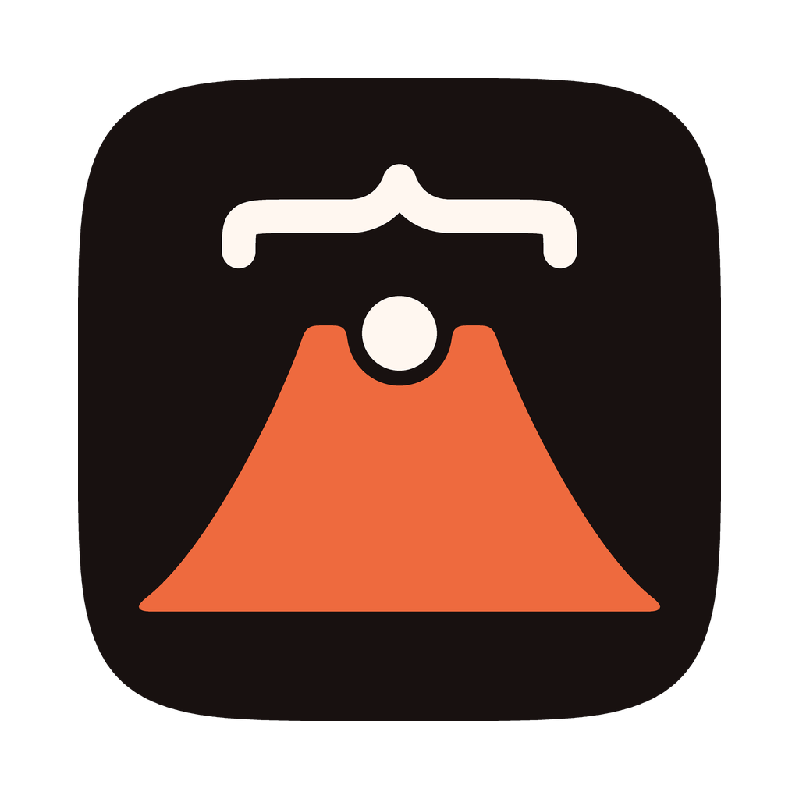
  <h1>Olympus Coder</h1>
  <p><strong>One native workspace for every ACP coding agent — with shared project memory, multi-agent orchestration, a built-in code workbench, and end-to-end encrypted phone access.</strong></p>
  <p>
    <code>v0.3.1</code> · <code>Apache-2.0</code> · <code>macOS · Windows · Linux</code> · <code>ACP 2.6 + MCP</code> · <code>Electron · React 19 · TypeScript</code>
  </p>
  <h3>⚡ 2.5B+ Free Coding Tokens / Month — 18 Free-Tier Coding CLIs Built In</h3>
  <p>
    <strong>100% free desktop IDE · Zero mandatory account wall.</strong> Install and sign in to <strong>18 free-tier coding agents</strong> directly inside Olympus Coder — stacking recurring free allowances across <strong>Qwen Code</strong>, <strong>Gemini CLI</strong>, <strong>iFlow CLI</strong>, <strong>OpenCode</strong>, <strong>Olympus CLI</strong>, <strong>Google Antigravity</strong>, <strong>OpenAI Codex</strong>, <strong>GitHub Copilot Free</strong>, <strong>Kiro</strong>, <strong>Kilo</strong>, <strong>Cline</strong>, <strong>Codebuddy</strong>, <strong>Qoder</strong>, <strong>Cursor</strong>, <strong>ZCode</strong>, <strong>Mistral Vibe</strong>, <strong>Goose</strong>, and <strong>OpenHands</strong> — and switch agents mid-thread without losing shared project memory when a quota resets.
  </p>
</div>

<br />

<picture>
  <source media="(prefers-color-scheme: light)" srcset="docs/screenshots/light-mode.png" />
  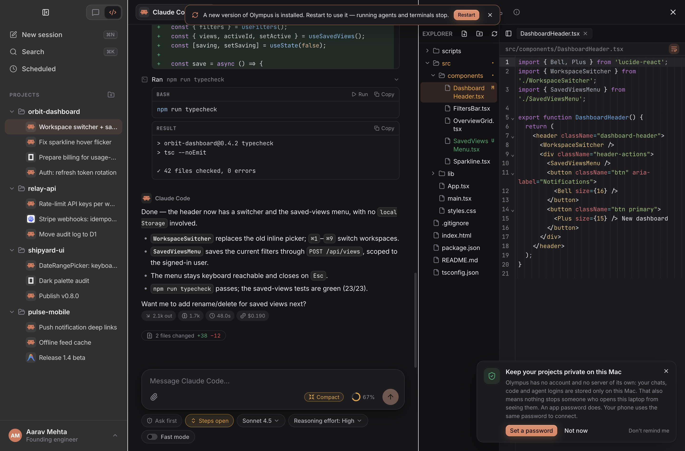
</picture>

> **Status:** v0.3.1, under active development. macOS is the primary platform for day-to-day use and testing; the Windows and Linux installers build in CI, but have had less live testing.

## Download

Get the latest installer from **[Releases](https://github.com/martianacademy/olympus-coder/releases/latest)**:

| Platform | File |
| --- | --- |
| macOS, Apple silicon | [`Olympus.Coder-0.3.1-arm64.dmg`](https://github.com/martianacademy/olympus-coder/releases/latest/download/Olympus.Coder-0.3.1-arm64.dmg) |
| macOS, Intel | `Olympus.Coder-<version>.dmg` (coming soon) |
| Windows (x64) | `Olympus.Coder.Setup.<version>.exe` (coming soon) |
| Linux (x64) | `Olympus.Coder-<version>.AppImage` or `olympus-coder_<version>_amd64.deb` (coming soon) |

Each release includes `SHA256SUMS.txt` (`shasum -a 256 -c SHA256SUMS.txt`). The builds are ad-hoc signed but not notarized yet. On macOS, if the app is reported as damaged or from an unidentified developer, run `xattr -dr com.apple.quarantine "/Applications/Olympus Coder.app"` once after moving it to Applications. On Windows, choose **More info → Run anyway** in SmartScreen.

### Headless VPS / Cloud Server (Control from Phone or Browser — Zero Electron, Zero SSH)

Run the full Olympus Coder workspace (Claude Code, Codex, Gemini CLI, Qwen Code, OpenCode, `oly`, CodeMirror editor, Git & Worktrees, live PTY terminals, and shared `~/.olympus` memory) on any Linux VPS or remote Mac in pure Node.js — no GUI/X11 required:

```sh
curl -fsSL https://raw.githubusercontent.com/martianacademy/olympus-coder/main/scripts/install-server.sh | sh
olympus-server serve --relay --project .   # or: oly serve --relay --project .
```

Scan the ASCII QR code printed in your terminal to open the full responsive Olympus Coder UI on your phone or laptop over the **AES-256-GCM end-to-end encrypted Cloudflare Relay** (or pass `--lan` / `--no-relay` for local/Tailscale-only use). To keep it running after SSH logout and reboots on Linux:

```sh
mkdir -p ~/.config/systemd/user
olympus-server serve --relay --print-systemd > ~/.config/systemd/user/olympus-server.service
systemctl --user enable --now olympus-server
```

---

## Why Olympus Coder?

Modern AI-assisted engineering often splits context across disconnected CLI terminals, vendor-locked desktop apps, and isolated memory folders (`~/.claude`, `~/.codex`, `~/.gemini`). Switching from one coding agent to another mid-task usually means re-explaining architecture, losing file checkpoints, and managing background workers blind.

**Olympus Coder** brings every [Agent Client Protocol (ACP)](https://agentclientprotocol.com) coding agent into a single desktop and mobile-ready IDE:

- **Switch agents mid-conversation** — Start an investigation in **Antigravity**, hand implementation to **Claude Code**, and request a read-only **Second Opinion** from **Codex** in the same thread without losing context.
- **One shared `~/.olympus` brain** — Every agent reads and updates the same two-tier persistent project memory (`MEMORY.md`, `INSTRUCTIONS.md`, `BUGS.md`, `AGENTS.md`, and cross-agent session transcripts) instead of writing into siloed vendor directories.
- **Full IDE workbench built in** — Inspect live edits in **CodeMirror 6**, stage and commit in the **Git** client, run multi-tab **WebGL terminals** with 1-click test reruns, roll back any prompt via **shadow-git checkpoints**, and preview localhost apps side by side.
- **Continue from your phone anywhere** — The exact same responsive UI runs over local Wi-Fi/Hotspot (`:47816`) or an **AES-256-GCM end-to-end encrypted Cloudflare Relay** with full chat, tool approvals, file editing, Git, and live PTY terminals.

---

## 2.5B+ Free Coding Tokens / Month — 18 Free-Tier Providers

Olympus Coder never locks the IDE behind a login or subscription. You can install, add, and authenticate **18 free-usage coding CLIs** directly from **Settings → Agents & login** (or Onboarding), and rotate across them seamlessly inside the same conversation whenever one provider's daily or monthly window resets:

| Agent / CLI | Recurring Free Allowance | 1-Click Install / Add | Direct In-App Sign-In |
| :--- | :--- | :--- | :--- |
| **Olympus CLI** (`oly`) | OpenRouter `:free` models (BYO key) & unlimited local Ollama (`$0`) | Built-in (`npm` 1-click install) | BYO API keys (OpenRouter, Anthropic, OpenAI), Local Ollama, or `oly login` terminal |
| **Qwen Code** (`qwen-code`) | **2,000 free requests / day** (`~1.5B tokens/mo` at ~25k coding context) | `npx` or local `qwen` | In-app terminal (`qwen` OAuth) or `DASHSCOPE_API_KEY` |
| **Gemini CLI** (`gemini`) | **~1,000 free requests / day** on personal Google accounts (`~750M tokens/mo`) + free AI Studio key | `npx` or local `gemini` | Google OAuth / in-app terminal (`/auth`) or `GEMINI_API_KEY` |
| **iFlow CLI** (`iflow`) | **Uncapped free** hosted Kimi K2, Qwen3 Coder & DeepSeek-V3 | `npx @iflow-ai/iflow-cli` or local `iflow` | In-app terminal (`iflow` sign-in) or `IFLOW_API_KEY` |
| **OpenCode** (`opencode`) | **12 zero-key `$0` built-in models** (`big-pickle`, `mimo-v2.6-flash-free`, `deepseek-v4.1-flash-free`, etc.) | Verified binary download or local `opencode` | Works out of the box, `opencode auth login`, or provider keys |
| **Google Antigravity** (`agy`) | Free personal Google account quota across Gemini & frontier models | Built-in (`agy` CLI) | 1-click Google OAuth (`oauth-personal`) or `GEMINI_API_KEY` |
| **OpenAI Codex** (`codex`) | ChatGPT Free account weekly Codex CLI allowance | Built-in (`npm` 1-click install) | 1-click ChatGPT browser / device-code login or `CODEX_API_KEY` |
| **GitHub Copilot** (`github-copilot-cli`) | **Copilot Free** (50 agent/chat requests + 2,000 completions / month) | `npx` or local `copilot` | In-app terminal (`copilot login`) or `GITHUB_TOKEN` |
| **Kiro CLI** (`kiro`) | AWS Builder ID Free Tier (**50 free agentic interactions / month**) | Verified binary download or local `kiro-cli` | In-app terminal (`kiro-cli login` via Builder ID / Google / GitHub) |
| **Kilo** (`kilo`) | Free signup credits + `$0` free community models | Verified binary download, `npx`, or local `kilo` | In-app terminal (`kilo auth login`) or `KILOCODE_TOKEN` / free keys |
| **Cline** (`cline`) | Free models + starter credits + BYO free Gemini / OpenRouter keys | `npx` or local `cline` | In-app terminal (`cline auth`) or Keychain API keys |
| **Codebuddy Code** (`codebuddy-code`) | Tencent Cloud free tier with `Auto` model routing & starter quota | `npx` or local `codebuddy` | In-app terminal (`codebuddy login`) or `CODEBUDDY_API_KEY` |
| **Qoder CLI** (`qoder`) | Community Free Edition + 14-day Pro trial credits | `npx` or local `qodercli` | In-app terminal (`qodercli login`) or `QODER_PERSONAL_ACCESS_TOKEN` |
| **Cursor** (`cursor`) | Cursor Free / Hobby monthly agent request allowance | Verified binary download or local `cursor-agent` | In-app terminal (`cursor-agent login`) |
| **ZCode** (`zcode`) | Z.ai `zai-start-plan` free GLM coding tier | `npx zcode-acp-server` bridge | ZCode desktop app session or `ZAI_API_KEY` / `ZHIPU_API_KEY` |
| **Mistral Vibe** (`mistral-vibe`) | Mistral La Plateforme free **Experiment** API tier | Verified binary download or local `vibe-acp` | Browser sign-in or `MISTRAL_API_KEY` |
| **Goose** (`goose`) | Open-source agent (`$0` with free Gemini / OpenRouter keys or Ollama) | Verified binary download or local `goose` | In-app terminal (`goose configure`) or `GOOSE_PROVIDER` + key |
| **OpenHands** (`openhands`) | Open-source agent (`$0` with free Gemini / OpenRouter keys or Ollama) | `uvx openhands` or local `openhands` | In-app terminal (`openhands login`) or `LLM_API_KEY` / `GEMINI_API_KEY` |

<sub><strong>How the ~2.5B+ monthly token math works:</strong> Qwen Code (`60,000 req/mo`) and Gemini CLI (`~30,000 req/mo`) alone provide ~2.25B tokens/month at a typical ~25k-token multi-file coding context, before counting uncapped free hosted models on <strong>iFlow CLI</strong>, 12 zero-key <code>$0</code> models in <strong>OpenCode</strong>, recurring monthly allowances across <strong>Antigravity</strong>, <strong>Codex</strong>, <strong>Copilot Free</strong>, <strong>Kiro</strong>, <strong>Mistral Experiment</strong>, OpenRouter <code>:free</code> pools, and unlimited local <strong>Ollama</strong> inference. Quotas are governed by each upstream provider and may change over time.</sub>

---

## What's new in 0.2

**You can see the problem on screen, but saying where it is takes a paragraph.**
Image and video attachments now have **Mark up**. Draw with a pen, highlighter, rectangle, circle, arrow, freehand shape, text or numbered pins, then press **Done**: the marks are baked into a new PNG at the original's resolution, the original stays attached unless you untick **Also send the original**, and the agent gets a short legend right before the image, e.g. `1. Red circle around x 1720–2480, y 680–910 (middle right) — text: "make this smaller"`. Agents can't watch video, so for a video you mark one frame (saved with its timestamp) or one area across a time range, which becomes a contact sheet of 4–6 evenly spaced frames with the mark and the timestamp on each. Images already in a chat have **Mark up & add to message** in the viewer.

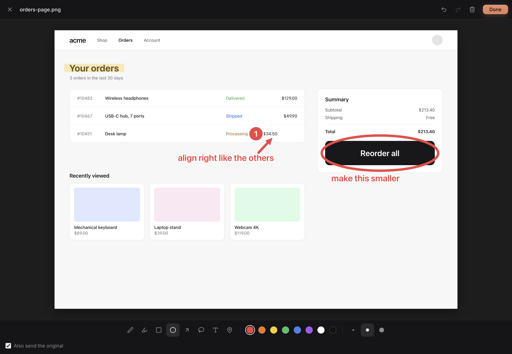

**Adding another agent meant leaving the chat for Settings.**
Agents can now search the ACP registry and add or remove CLI agents themselves with the Olympus tools `search_agent_registry`, `add_agent`, `add_custom_agent` and `remove_agent`. Every change waits for an Olympus confirm card that shows the exact command, and **Approve all** never answers it for you. A custom command is saved only if it answers an ACP `initialize`; built-in agents and agents a running chat is using can't be removed. Sub-sessions don't get these tools.

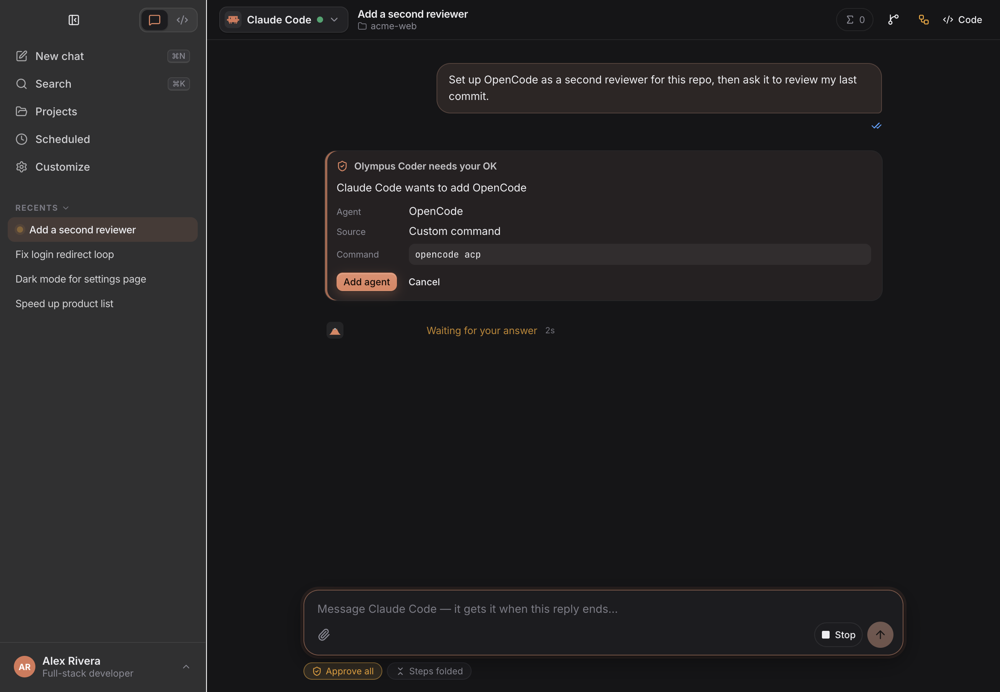

**Some appearance settings only reached part of the app.**
Settings → Appearance adds **Steps & tool output size** (Smaller, Default, Larger, Largest, with a live preview) and **Chat width** (Narrow, Default, Wide). **Density** (Comfortable or Compact) now changes the spacing of the chat, steps, sidebar and composer on desktop, and **corner radius** and **app font size** now reach message bubbles, code blocks, cards, menus, the chat and the sidebar.

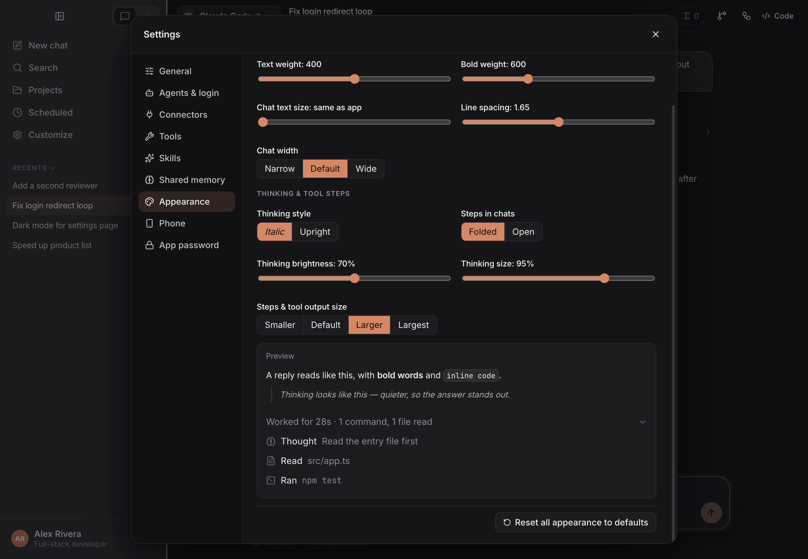

**You only found out about a new version by checking GitHub.**
Olympus checks GitHub Releases shortly after it starts and once a day. Settings → General → **Updates** has three modes: **Notify me** (a small notice with **What's new** and a **Download** link for the right installer; closing it skips that version), **Automatic** (from 0.2.1 on: downloads the update in the background, checks it against the release's `SHA256SUMS.txt`, and installs it when you press **Restart** or quit, putting the previous version back if any step fails; tested on macOS, the Windows and Linux installers are not yet tested on real machines) and **Off**. **Check now** checks right away.

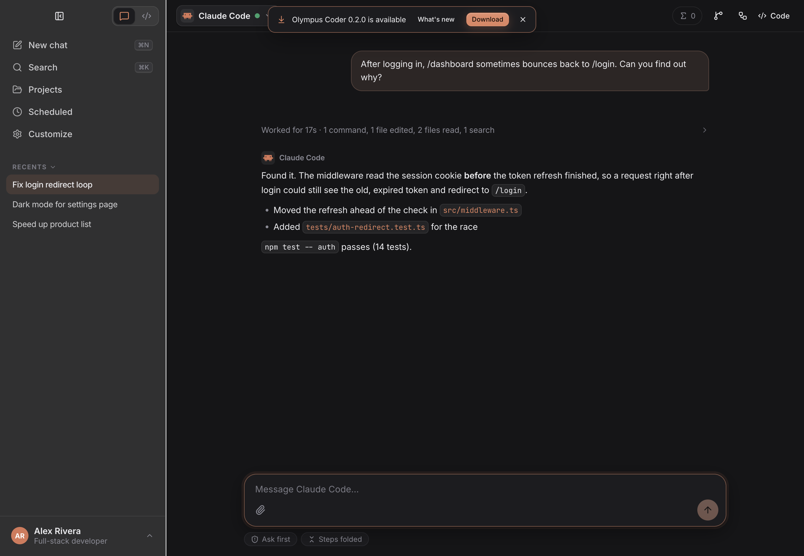

**Olympus messaged agents whenever a command or sub-session finished, which cost extra turns.**
Those messages are now off by default (Settings → General → **Message agents when their work finishes**). Agents check their own pending work instead: every session has a `set_timer` tool (1 to 1440 minutes) for a reminder, or uses its CLI's own background mode. Sub-sessions are now disposable by default: once one has finished and its parent has read the report, it deletes itself. Pass `keep: true` to keep one.

**Shared data lived in `~/.agents`, a folder other tools use too.**
It now lives in `~/.olympus` (override with `OLYMPUS_HOME`). On first launch Olympus copies its own items from `~/.agents` into a staging folder and moves them into place only when the whole copy succeeded, so a failed copy changes nothing and is retried on the next launch. `~/.agents` itself is never modified, and skills installed with `npx skills` stay where they are. A project whose folder was moved or renamed shows **Folder not found · Locate…** in the sidebar; pick the new folder and its chats and memory follow.

**The phone page could break after a relay update, and was too short on iPhone.**
A page left open while the relay is redeployed now reloads into the new version instead of failing to open chats (earlier page files are kept for 30 days). Opened from the iPhone home screen, the app uses the full screen height. The relay is rate-limited per IP (60 connections and 10 new rooms a minute) and each phone connection is capped at 300 messages per 10 seconds.

**Smaller changes**
- The composer's text box has a drag handle to resize it (remembered per device; double-click resets).
- **Edit** on a queued message moves it back into an empty composer, or opens an edit window when the composer already has a draft.
- Explorer rows (right-click, or the project header) offer **Open in** your installed editors, **Open with default app**, **Reveal in Finder**, **Copy relative path**, **Rename** and **Move to Trash**.
- The working indicator sits in the same logo box as the agent logos.
- In Code mode the composer no longer shows the Compact chip; the context ring opens the Info panel, where Compact is.

---

## What's new in 0.3

**Saying where a bug is, out loud, still meant typing.**
Settings → **Voice** adds a transcription engine behind the mic button next to **Send**: **System dictation** (the OS's own, the default — nothing is recorded by Olympus), **Whisper on this computer** (whisper.cpp is auto-detected on your machine — never downloaded — with its models listed and an *Add model file…* picker), **OpenRouter** (reuses an agent's key or one you save here) and **Custom / local server** (any OpenAI-compatible `/v1/audio/transcriptions`). A **Language** list includes **Hinglish (Roman letters)**, and **Record 5 s** tests an engine right in the panel. Recording engines work only on the desktop window — the phone page never touches the mic — and macOS asks once for microphone permission.

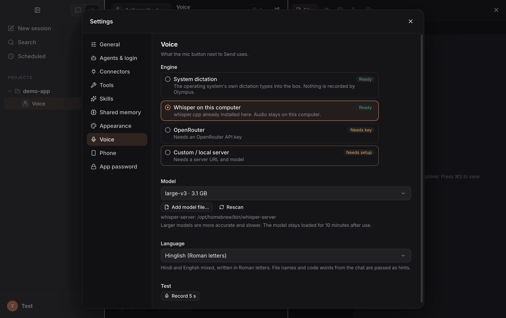

**The right panel had its own grey, so the three panels looked like three apps.**
The workbench (files, editor, terminal, Git) now uses the same surface as the sidebar — matching panel colour in light and dark, and the same macOS translucency when it's on — while the chat column stays its own surface in the middle.

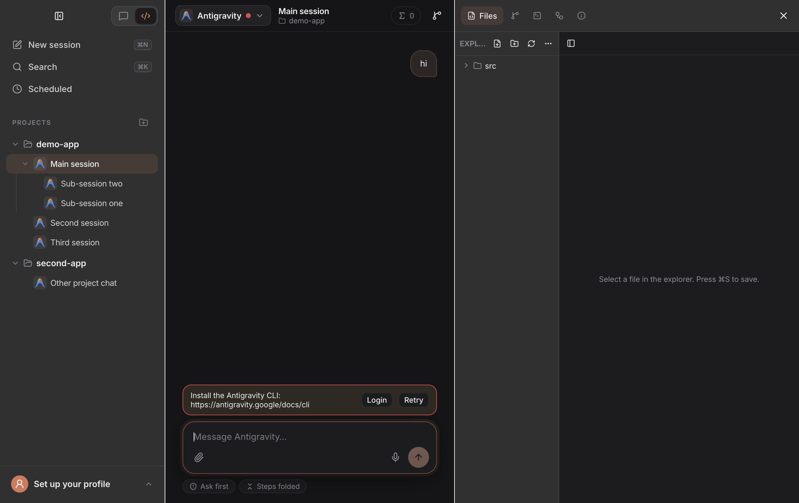

**Sidebar rows were squeezed together with no way to space them out.**
Settings → Appearance → Theme & Colors → **Sidebar** adds **Project spacing**, **Session spacing** (sessions and sub-sessions) and **Sidebar text size**, applied live to projects, sessions and sub-sessions alike.

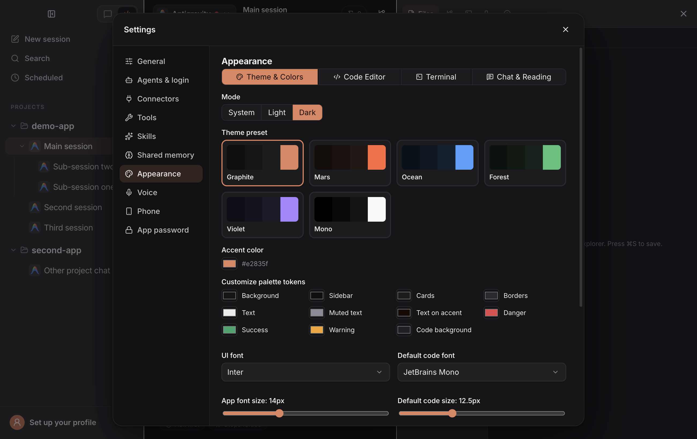

**A slow chat switch briefly showed the previous chat, and background windows kept polling.**
Switching chats now shows a loading skeleton instead of the previous chat's messages. Polls (thread status, terminals, sub-sessions) run only while the page is actually visible — a hidden window or a background phone page stops them and gets one fresh run the moment it comes back.

**You had to keep an eye on the Tasks panel to learn a sub-session had finished.**
The moment a sub-session finishes, Olympus tells its parent session the result — status, agent, time, changed files and the report (up to ~1,500 characters) — even mid-turn. Settings → General → **Tell the main session when a sub-session finishes** turns it off.

---

## Highlights

### 1. Multi-Agent ACP Hub & 1-Click Registry

- **First-class built-in agents & Olympus CLI:** Ships ready for **Claude Code** (`@agentclientprotocol/claude-agent-acp`), **Codex** (`@agentclientprotocol/codex-acp`), and **Google Antigravity** (`agy acp`), reusing existing CLI logins, models, and reasoning effort levels. It also lists **Olympus** (`oly acp`), our multi-model agent for OpenRouter, Vercel AI Gateway, any OpenAI-compatible key, or local Ollama. Install it separately from [olympus-coder-cli](https://github.com/martianacademy/olympus-coder-cli).
- **46+ official & curated ACP agents:** Browse, auto-detect on `PATH`, or 1-click install ACP coding agents (`gemini`, `opencode`, `qwen`, `iflow`, `copilot`, `kilo`, `cline`, `codebuddy`, `qoder`, `kiro`, `cursor-agent`, `zcode`, `goose`, `openhands`, and more) via `local`, `npx`, `uvx`, or `sha256`-verified binary archives into `~/.olympus/agents/`, with unified in-app terminal & Keychain API-key login (`src/main/acpAuth.ts`, `src/main/acpAuthCatalog.ts`).
- **Custom providers & commands:** Point any compatible agent at custom Anthropic- or OpenAI-compatible API gateways (`src/main/acpProviders.ts`) with OS-encrypted API keys, or register arbitrary stdio ACP binaries.
- **Mid-chat agent handoff & CLI session import:** Switching the agent selector mid-thread automatically synthesizes prior goals, turns, and modified files for the incoming agent. Existing CLI conversations can also be browsed and imported via native ACP `session/list` and `session/load`.

### 2. Two-Tier Persistent Context (`~/.olympus`)

Olympus Coder enforces a structured, cross-agent memory hierarchy stored in `~/.olympus` (configurable via `OLYMPUS_HOME`; installs that used the old `~/.agents` folder are copied over once on first launch, and `~/.agents` is left as it was):

1. **Tier 1 — Shared Project Memory (`~/.olympus/memory/<project-slug>/`):** Indexed summaries and YAML frontmatter from `MEMORY.md`, `INSTRUCTIONS.md`, `BUGS.md`, topic notes, and user preferences (`~/.olympus/user/learned.json`), plus project-level `AGENTS.md` and `~/.olympus/skills/*/SKILL.md` (skills installed with `npx skills` in `~/.agents/skills` are listed too, read-only).
2. **Tier 2 — Cross-Agent Session Index (`~/.olympus/threads/`):** Recent session summaries across Claude Code, Codex, and Antigravity with direct transcript paths so a new session can pick up where an earlier session stopped.

Shared guidance is delivered cleanly via native ACP `systemPrompt` options (or `_meta.antigravity.systemPrompt.append` for Antigravity) while keeping your prompt bubble concise and preventing writes to private vendor memory silos.

### 3. Interactive ACP UX — Steps, Elicitation, Slash Menu & Queueing

<table>
  <tr>
    <td width="50%">
      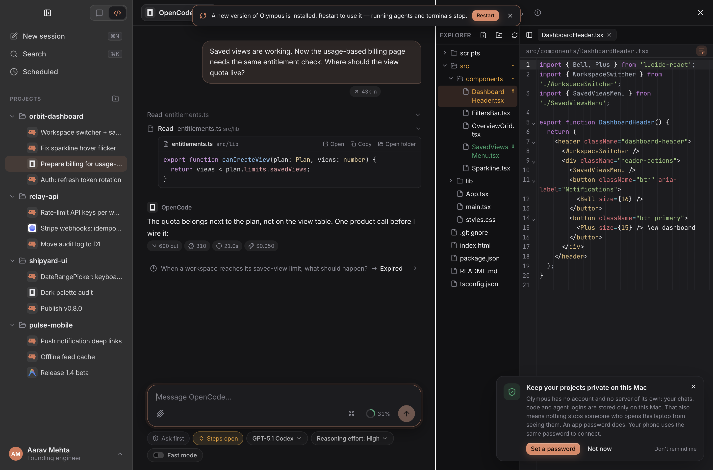
      <p align="center"><sub><strong>Native ACP Elicitation</strong> — Interactive single/multi-select cards, custom answers, and OAuth URL flows inline in chat.</sub></p>
    </td>
    <td width="50%">
      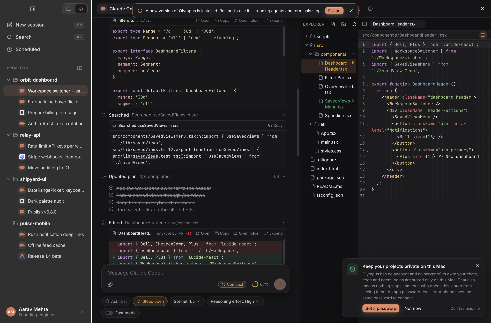
      <p align="center"><sub><strong>Rich Tool &amp; MCP Cards</strong> — Structured reads, grep hits, MCP server calls, inline images, and <code>file:line</code> jump links.</sub></p>
    </td>
  </tr>
</table>

- **Minimal collapsible `WorkGroup` timeline:** Consecutive thoughts, reads, edits, searches, MCP calls, sub-agents, and plan updates fold into a calm monochrome timeline with live volcano progress indicators — while immediately surfacing pending permission approvals so nothing blocks unseen.
- **Calm, readable output:** Static syntax highlighting in `BASH`, `RESULT`, read/edit/write and diff boxes — TypeScript, TSX, Python, JSON, shell and more — with dim line-number gutters that never leak into copied text.
- **In-chat media viewer & Add to message:** Click any image or video in a chat to open it in place with gallery arrows, wheel/pinch zoom, pan, download, and *Open in panel*. **Add to message** puts any chat file back into the composer without re-uploading it.
- **Context ring & Compact:** A quiet ring colour-codes how full the context is (green → yellow → red), with one-click `/compact` when the agent advertises the command. In Code mode the ring opens the Info panel, where Compact lives.
- **Send-while-busy queue & mid-turn steering:** Keep typing while an agent is working. Queue follow-up messages with edit/remove controls and delivery ticks, or steer active turns directly on agents supporting `_session/steering`.
- **`/` Slash command palette & boolean config pills:** Autocomplete agent-advertised slash commands (`/review`, `/compact`, `/init`, `/model`, `/status`, `/mcp`), toggle boolean session modes (`Fast mode`, `Ultracode`), and attach screenshots, PDFs, Office documents, audio, or videos with QuickLook previews.

### 4. Multi-Agent Orchestrator & Live `Tasks` Control

Every chat connects to Olympus Coder's built-in localhost MCP server (`olympus`), empowering a lead agent to coordinate parallel specialists:

- **Sub-session orchestration:** Spawn background worker sessions (`spawn_subsession`), wait on results (`wait_for_subsessions`), steer workers (`message_subsession`), or dynamically switch a worker to another agent/model (`configure_subsession`) if a provider hits quota limits. Finished one-off workers can be removed with `delete_subsession` (running ones are refused).
- **Unified `Tasks` visibility:** Watch Olympus sub-sessions, read-only **Second Opinion** forks, **native CLI sub-agents** (ACP `subagents`, JetBrains AIR `asyncTasks` / `backgroundSubagents`, Antigravity `transcript.jsonl`, and Claude subagent/workflow logs), and recurring cron/interval **Schedules** in one live panel.
- **OS process tree control & thermal guard:** Inspect every child process spawned by an agent with live CPU/RAM meters, **Pause** (`SIGSTOP`), **Resume** (`SIGCONT`), or **Stop** (`SIGTERM`) runaway builds, and get automatic alerts when sustained CPU load overheats your machine.

### 5. Code Mode Workbench, Shadow-Git Checkpoints & Live Console

<table>
  <tr>
    <td width="50%">
      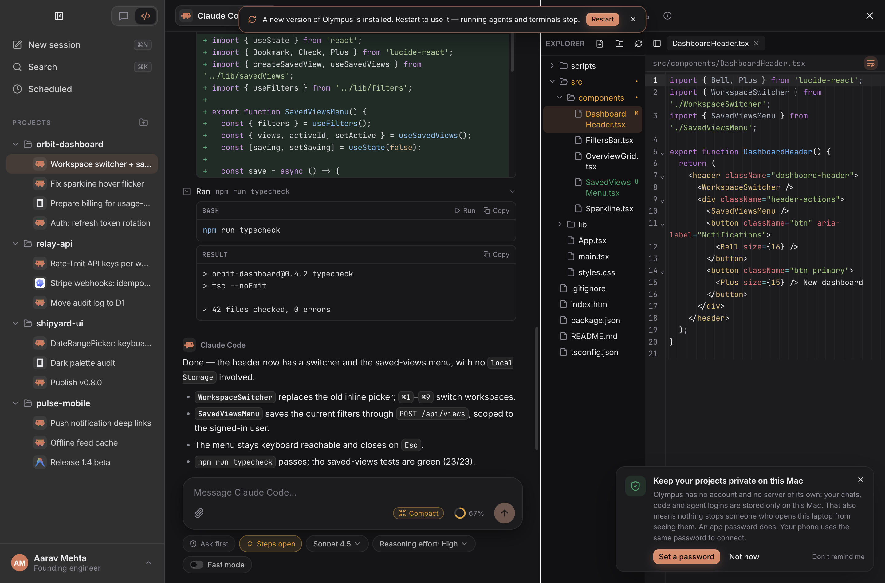
      <p align="center"><sub><strong>Live Command Console &amp; Unsaved Buffer Awareness</strong> — Streaming <code>BASH</code> / <code>RESULT</code> output alongside open editor tabs.</sub></p>
    </td>
    <td width="50%">
      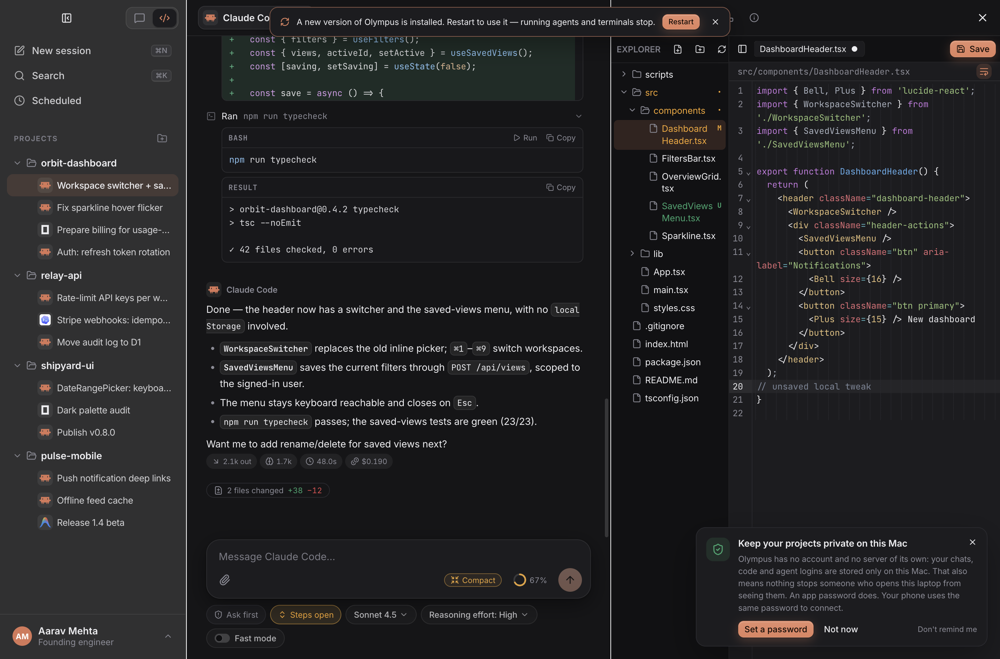
      <p align="center"><sub><strong>Turn Checkpoints &amp; Conflict Guard</strong> — Per-turn diff chips (<code>+3 -2</code>) and protection when an agent edits a file with unsaved changes.</sub></p>
    </td>
  </tr>
</table>

- **CodeMirror 6 Editor & Appearance Studio:** Multi-tab code editor with six syntax themes plus Auto (dark/light), Markdown/Mermaid/KaTeX split preview, relative line numbers, ligatures, column ruler, and unsaved-buffer awareness over ACP Client FS so agents read your latest in-memory edits without overwriting them silently.
- **Per-turn Shadow-Git Checkpoints:** Before each prompt, Olympus snapshots your working tree into a separate shadow Git store (Electron's `userData/checkpoints/`), giving you instant per-turn file diffs and 1-click **Undo / Redo** without polluting your repository's `.git` history.
- **Integrated Git Client:** Stage, unstage, discard hunks, inspect side-by-side diffs, commit, amend, push, pull, manage branches, merge, and stash directly from the Workbench.
- **WebGL Terminals, Test Runner & Port Manager:** Multi-tab `node-pty` + `@xterm/addon-webgl` terminals with `⌘F` search, error-line stepping, auto-detected 1-click **Run Tests** (*Rerun failed* / *Ask agent to fix*), `EADDRINUSE` port inspection & kill controls, optional messages to the agent when a background job finishes (off by default), and an embedded localhost **Web Preview** that captures browser console errors for the agent.
- **Project Analytics Dashboard:** Track token usage, cache hit rates, agent wall-clock time, turns, lines added/removed, and cost breakdowns per project and per agent.

### 6. Responsive Phone UI & End-to-End Encrypted Relay

<div align="center">
  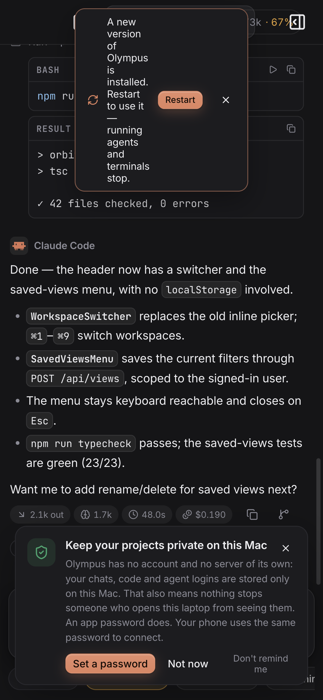
  &nbsp;&nbsp;&nbsp;&nbsp;
  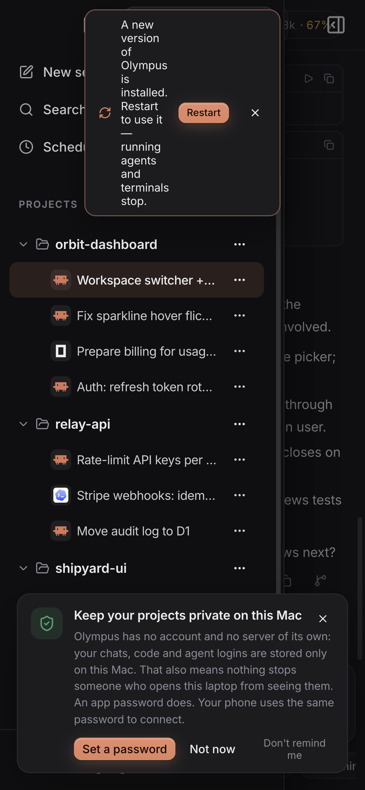
  <p><sub><strong>Full Mobile Parity (320px–Desktop)</strong> — Compact touch navigation, slide-over project &amp; sub-session drawer, live approvals, CodeMirror editing, Git, and PTY terminals from your phone.</sub></p>
</div>

- **Same-Wi-Fi & Personal Hotspot (`:47816`):** Enable Phone Access in **Settings → Phone**, scan the `#pair` QR code, and control your desktop workspace over local LAN or phone hotspot with zero cloud intermediaries.
- **Anywhere E2EE Cloudflare Relay (`relay/`):** Pair from cellular or external networks through a lightweight Cloudflare Worker + Durable Object WebSocket relay. Traffic is encrypted end-to-end with **AES-256-GCM** using a key stored strictly in the URL `#fragment` — the relay never sees plaintext prompts, code, or keys.
- **App Password & Touch ID Lock:** Both local and remote sessions are gated by `scrypt`-hashed password authentication (`src/main/lock.ts`), with native **Touch ID** unlock on macOS.

---

## Getting Started

### Prerequisites

- **Node.js** `22 LTS` or newer and `npm`
- **Build tools for `node-pty`:** Xcode Command Line Tools on macOS, `build-essential` + Python 3 on Linux, or Visual Studio C++ Build Tools on Windows
- **At least one ACP coding agent CLI** on macOS/Linux (such as `claude`, `codex`, or `agy`), or install any of the 46 registry agents directly inside **Settings → Agents & login**

### Run from Source

```bash
# Install dependencies and rebuild native modules (node-pty) for Electron
npm install

# Start Olympus Coder with hot reload
npm run dev
```

### Typecheck & Production Bundle

```bash
# Run full TypeScript verification across main, preload, renderer, and shared types
npm run typecheck

# Compile production bundles into out/main, out/preload, and out/renderer
npm run build

# Preview the compiled production build locally
npm run start
```

---

## Building Desktop Installers

Olympus Coder packages native installers via `electron-builder`:

```bash
npm run dist:mac     # macOS (.dmg and .zip for arm64 / x64)
npm run dist:win     # Windows (NSIS .exe installer for x64)
npm run dist:linux   # Linux (.AppImage and .deb for x64 / arm64)
```

CI builds all four targets on every `v*` tag (and manual dispatch) via `.github/workflows/build.yml`. Those artifacts are unsigned, so macOS shows "unidentified developer" and Windows SmartScreen may warn until you sign with your own certificate.

### Platform CLI Bundling Behavior

| Platform | Bundled Inside Installer | Host CLI Behavior |
| :--- | :--- | :--- |
| **macOS** (`arm64`, `x64`) | `@agentclientprotocol/claude-agent-acp`, `@agentclientprotocol/codex-acp` | Uses your installed `claude`, `codex`, `agy`, and `~/.olympus/agents/*` binaries + existing CLI logins |
| **Linux** (`x64`, `arm64`) | `@agentclientprotocol/claude-agent-acp`, `@agentclientprotocol/codex-acp` | Uses your installed `claude`, `codex`, `agy`, and `~/.olympus/agents/*` binaries + existing CLI logins |
| **Windows** (`x64`) | ACP adapters **plus** `@anthropic-ai/claude-code` & `@openai/codex` (`resources/bundled-clis/`) | Works out of the box with zero global Node/CLI setup; also detects external CLIs on `PATH` |

### Installing Locally on macOS (`/Applications`)

After running `npm run dist:mac`, copy the app bundle to `/Applications` and re-apply an ad-hoc signature so macOS Gatekeeper and Keychain/Touch ID prompts stay consistent across rebuilds:

```bash
# Quit Olympus Coder first (⌘Q), then replace the bundle and re-sign it
rm -rf "/Applications/Olympus Coder.app"
ditto "dist/mac-arm64/Olympus Coder.app" "/Applications/Olympus Coder.app"
codesign --force --deep --sign - "/Applications/Olympus Coder.app"
codesign --verify --deep --strict "/Applications/Olympus Coder.app"
```

On Intel Macs the packaged bundle is under `dist/mac/` instead of `dist/mac-arm64/`.

---

## Self-Hosting the E2EE Phone Relay (Optional)

Same-Wi-Fi phone access works locally with zero cloud setup. To host your own **Cloudflare Worker + Durable Object** relay for cellular/remote access:

```bash
# 1. Build the desktop renderer and sync static web assets into relay/public
npm run build
node relay/scripts/copy-page.mjs

# 2. Deploy the Worker + Room Durable Object to your Cloudflare account
cd relay
npm install
npx wrangler deploy
```

Then paste your deployed `https://<your-worker>.workers.dev` URL into **Settings → Phone → Relay URL**.

---

## Architecture & Repository Layout

```text
.
├── build/                      # macOS/Windows/Linux icons and DMG background assets
├── docs/screenshots/           # High-DPI desktop (dark/light) and mobile UI screenshots
├── relay/                      # Cloudflare Worker + Durable Object E2EE WebSocket relay
│   ├── public/                 # Synced responsive web client served to paired phones
│   ├── scripts/copy-page.mjs   # Copies out/renderer assets into relay/public
│   └── src/index.ts            # Stateless ciphertext room router (zero plaintext access)
├── scripts/
│   ├── acp-sessions.unit.mjs   # Unit tests for ACP session capabilities and lifecycle
│   ├── cdp.mjs                 # Chrome DevTools Protocol driver for off-screen E2E checks
│   ├── make-icons.py           # Brand icon generator
│   └── probe-acp.mjs           # Standalone CLI ACP handshake diagnostic tool
├── tests/                      # Unit suites (ACP client/config/content, limits, queue, highlighting, remote stream)
└── src/
    ├── shared/                 # Cross-process TypeScript contracts, quota & model helpers
    ├── preload/                # Context-isolated window.olympus IPC bridge
    ├── main/                   # Electron main process (Node.js)
    │   ├── agents.ts           # ACP stdio client manager, mid-chat handoff, model/mode sync
    │   ├── acpClientFs.ts      # Sandboxed fs/* RPC with unsaved editor buffer overlay
    │   ├── acpTerminals.ts     # ACP terminal/* RPC streamed live into chat & workbench
    │   ├── acpSessions.ts      # session/list, session/load, fork, resume, and delete flows
    │   ├── catalog.ts          # 46-agent ACP Registry client & sha256/npx/uvx installer
    │   ├── checkpoints.ts      # Shadow-git per-turn working-tree snapshots & undo/redo
    │   ├── elicitation.ts      # Interactive ACP form & URL elicitation broker
    │   ├── guide.ts            # Two-tier ~/.olympus persistent context & system prompt builder
    │   ├── memory.ts           # Shared project memory indexer (MEMORY.md, BUGS.md, learned.json)
    │   ├── nativeSubagents.ts  # ACP subagents + JetBrains AIR asyncTasks/backgroundSubagents
    │   ├── orchestrator.ts     # Localhost olympus MCP server (sub-sessions, schedules, terminals)
    │   ├── promptQueue.ts      # Send-while-busy prompt queue & _session/steering coordinator
    │   ├── remote.ts           # LAN HTTP/WS server (:47816), Bonjour mDNS & pairing QR
    │   └── relay.ts            # Desktop AES-256-GCM encrypted tunnel client for Cloudflare Relay
    └── renderer/               # Unified responsive React 19 + CodeMirror 6 + xterm.js UI
        └── src/
            ├── components/     # Chat, WorkGroup, StepBox, SlashMenu, ElicitationCard, Workbench
            ├── settings/       # Agents, Connectors (MCP), Shared Memory, Appearance, Phone, Lock
            └── remote/         # Browser WebSocket/E2EE transport shim matching window.olympus
```

### Key Environment Variables

| Variable | Purpose |
| :--- | :--- |
| `OLYMPUS_HOME` | Override the default `~/.olympus` shared root (useful for isolated workspaces or CI tests) |
| `AGENTDESK_SHARED_ROOT` | Older name for the same override, still honoured |
| `OLYMPUS_TEST_HIDDEN=1` | Launch Electron completely hidden (no dock icon, no window focus steal) for automated CDP testing |

---

## Verification & Testing

Olympus Coder supports headless, focus-free verification so automated checks never interrupt active desktop work:

```bash
# Static type checking
npm run typecheck

# All checked-in unit suites (Node 22+; TypeScript imports use the built-in type stripper)
for t in tests/*.unit.mjs; do node --experimental-strip-types "$t" || exit 1; done

# ACP session capability & store suite
node scripts/acp-sessions.unit.mjs

# Hidden Electron launch with CDP inspection (never steals macOS focus or keyboard)
OLYMPUS_TEST_HIDDEN=1 npx electron . \
  --user-data-dir=/tmp/olympus-e2e-profile \
  --remote-debugging-port=9333
```

---

## Security & Privacy Model

- **Local-first state:** Threads, project metadata, checkpoints, and memories live on your disk under `~/.olympus` and Electron's `userData` directory.
- **Encrypted provider secrets:** Custom model provider API keys are encrypted at rest via Electron `safeStorage` (macOS Keychain / Windows DPAPI / Linux Secret Service) and injected only into the target agent's process environment.
- **Zero-knowledge relay:** Remote phone sessions through `relay/` derive an `AES-256-GCM` session key encoded after `#` in the pairing QR link. Because URL fragments are never sent in HTTP requests, the Cloudflare Worker relays opaque encrypted frames without ever possessing the decryption key.
- **Guarded filesystem & process boundaries:** ACP Client FS enforces project-root path sandboxing and symlink escape checks (`acpClientFs.ts`), while a per-agent **Ask first / Approve all** switch keeps destructive shell commands under explicit user control.

---

## Contributing

Pull requests are welcome. See [CONTRIBUTING.md](CONTRIBUTING.md) for the checks to run and how to sign off commits (DCO).

## License

Olympus Coder is open source under the [Apache License 2.0](LICENSE). You may use, modify and distribute it, including commercially, under its terms. See [NOTICE](NOTICE) for attribution. "Olympus Coder" and its logo identify this project; the license does not grant rights to use them for other products (Apache-2.0, section 6).
